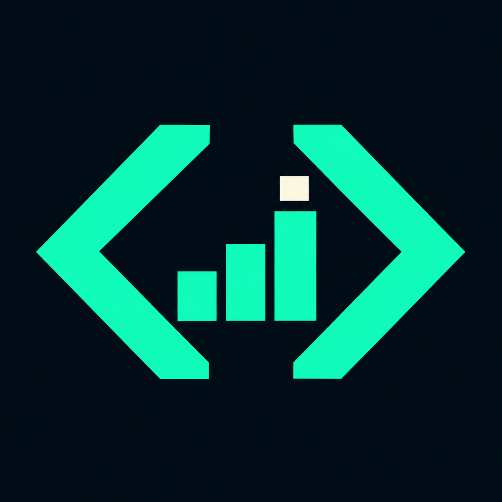

<p align="center">
  
</p>

# SDKBench

[](https://pypi.org/project/sdkbench/)
[](https://github.com/sdkbench-org/sdkbench/actions/workflows/ci.yml)

**Reproducible SDK performance and correctness benchmarks, starting with quantum development kits.**

SDKBench generates deterministic circuit workloads, runs them through native SDK APIs, records raw timings and summary statistics, and checks results against an independent NumPy statevector oracle. The first release supports **Qiskit** and **Cirq**, with a built-in reference adapter for validation and harness development.

Version 0.2.0 includes the legacy timing harness and the [P0 foundation](docs/implementation/P0_FOUNDATION.md) for the candidate task protocol. It does not establish a comprehensive SDK ranking. The generators, evaluator and SDK adapters are independently implemented in this repository. No cloud account, API key, quantum device or network access is required to run benchmarks.

## Requirements and task design

SDKBench is developing a task-first, participant-neutral requirements baseline. Start with the [requirements map and documentation guide](docs/requirements/README.md), then review the [user task catalog](docs/requirements/TASK_CATALOG.md), [task-capability-function matrix](docs/requirements/TRACEABILITY.md), and [acceptance contracts](docs/requirements/ACCEPTANCE.md).

The catalog describes user needs across computing models and software roles. It is a requirements baseline, not a claim that the current package implements those tasks or that any SDK supports them. [Governance rules](docs/requirements/GOVERNANCE.md) separate applicability, evidence, attribution and comparison from participant preferences.

The [implementation roadmap](docs/implementation/README.md) assigns all 92 task families to phases and specifies ten first-wave workflows with 24 input/reference fixtures, acceptance thresholds, resource caps and comparison cohorts. This is a candidate protocol, not benchmark results or an implemented replacement for the 0.1 harness.

## Install

Python 3.11 or newer is required.

```bash
# Core harness and NumPy reference adapter.
pip install sdkbench

# Optional real SDK adapters.
pip install 'sdkbench[qiskit]'
pip install 'sdkbench[cirq]'
pip install 'sdkbench[all]'
```

Optional SDKs are imported only when selected. The reference adapter is an oracle and smoke-test baseline; its timings are not a substitute for a production quantum SDK.

## Quick start

```bash
sdkbench list

# Runs without either optional SDK; compilation is explicitly skipped.
sdkbench run --qubits 4 --repeats 3 --output reference.json

# Same circuits and operations through two real SDKs.
sdkbench run --sdk qiskit --sdk cirq --qubits 8 --depth 4 \
  --seed 42 --repeats 10 --warmups 2 \
  --output results.json --csv results.csv

# Select a workload and operation; these flags may be repeated.
sdkbench run --sdk qiskit --workload brickwork --operation compile \
  --qubits 6 --depth 8 --output compile.json

# Compare matching configurations across runs or SDK versions.
sdkbench compare baseline.json candidate.json --output comparison.json
```

Without `--output`, `run` writes the full JSON report to stdout. With it, stdout contains a status summary. CSV is an additional flat export. A completed run exits 0 if at least one case passes and no cases fail or error. Missing optional SDKs and unsupported operations are reported as skipped; an entirely skipped run exits 1. Correctness failures or runtime errors exit 1. Invalid parameters, malformed comparison input and file errors exit 2.

## Workloads

| Workload | Circuit |
| --- | --- |
| `ghz` | H on logical qubit 0, followed by a nearest-neighbor CNOT chain |
| `qft` | Forward QFT with controlled phases and no final bit-reversal swaps |
| `brickwork` | Seeded RY/RZ layers with alternating nearest-neighbor CNOT pairs |
| `echo` | A brickwork circuit followed by its exact inverse |

All SDKs receive the same ordered gate sequence. Logical qubit 0 is the **least significant bit** of statevector indices; Cirq qubit ordering is explicitly adapted. Angles are in radians. `--depth` controls brickwork layers and the forward half of echo; it does not change GHZ or QFT. The seed fixes circuit angles, validation probes and Qiskit's compiler seed. Width is restricted to **2–16 qubits** to keep statevector validation bounded; depth is 1–256. The suite is designed for small, locally verifiable experiments in this first release.

## Measured operations

| Operation | Timed work | Validation |
| --- | --- | --- |
| `build` | Construct a fresh native circuit from the shared gate sequence | Native output statevectors versus the original circuit |
| `inverse` | Construct the native circuit inverse | Versus the reference inverse |
| `compose` | Compose the native circuit with itself | Versus two sequential applications |
| `simulate` | Evolve the all-zero state, including its allocation, to a complex128 statevector | Versus reference simulation |
| `compile` | Native compilation to full CZ gates and arbitrary one-qubit gates | Versus the original circuit |

SDK imports, workload generation, initial native circuit preparation, correctness checks and report writing are **outside** the timing intervals. Operations return fresh outputs; warmups run before recorded samples. `simulate` includes state allocation and native simulation setup performed by the adapter. Cirq's simulator object is constructed once outside timing. Garbage collection and SDK caching use their normal process settings; warmups do not imply a cold start.

Compilation uses all-to-all connectivity, no measurements, no noise and no hardware routing. Qiskit uses basis `['u', 'cz']`, optimization level 2 and `seed_transpiler`; Cirq uses `CZTargetGateset(allow_partial_czs=False)`. They target the same primitive family but use different optimization algorithms and native single-qubit representations. Output gate counts, two-qubit gate counts and SDK-native circuit depth are recorded. Depth definitions and scheduling may differ by SDK, and native gate count alone is not a quality ranking. The reference adapter has no compiler and reports this as skipped.

## Correctness and reporting

Every measured case is checked after timing on three inputs: all-zero, all-one and a seeded normalized complex random state. Outputs must be finite, normalized and equal to the reference up to a global phase, with absolute tolerance `1e-8`. The timed simulation output is checked directly for the all-zero input. These probe checks detect practical adapter and transformation errors; they are not a proof of unitary equivalence on every possible input. Tests additionally check every computational basis state for three-qubit workloads and use analytic checks of GHZ, QFT and individual gates.

JSON reports include:

- Schema/package versions, UTC timestamp, Python/OS/architecture and available processor metadata.
- NumPy and selected SDK versions, compiler settings and selected thread environment variables.
- Complete run configuration and SHA-256 fingerprints of input gate sequences.
- Raw nanosecond samples, minimum, median, mean, maximum, sample standard deviation and linearly interpolated p95.
- Correctness status, validation settings, native output metrics and explicit failure/skip reasons.

`compare` requires identical configurations, matching result keys and matching input fingerprints. It compares only passed cases and reports `speedup = baseline_median / candidate_median`: values above 1 mean a faster candidate. Failed and skipped cases retain their statuses. SDK versions may differ intentionally for regression checks. Environment differences are flagged using the recorded metadata; this is not a hardware equivalence guarantee or statistical significance test.

Run benchmarks serially on an otherwise idle machine. Record thread settings, dependencies, power settings and hardware when sharing results. For example, set `OMP_NUM_THREADS=1 OPENBLAS_NUM_THREADS=1` before launching a process if a single-thread experiment is intended. SDKBench records selected settings but does not impose a universal thread policy or publish leaderboard claims.

## Python API

```python
from sdkbench import run_benchmarks, write_json, write_csv, compare_reports

report = run_benchmarks(
    sdks=['qiskit', 'cirq'],
    workloads=['ghz', 'brickwork'],
    operations=['build', 'simulate', 'compile'],
    n_qubits=6, depth=4, seed=42, repeats=5, warmups=1,
)
write_json(report, 'results.json')
write_csv(report, 'results.csv')
print(report['summary'])
```

For local circuit experiments, `Circuit`, `Gate` and `make_workload` expose the immutable shared representation; `sdkbench.reference.simulate` provides the little-endian oracle. The reference simulator supports H, X, RY, RZ, CNOT and controlled-phase gates. This release focuses on ideal unitary circuits; noisy channels, shot-based sampling and remote execution are not measured.

## Development

```bash
python -m pip install -e '.[all,dev]'
python -m pytest -q
python -m build
python -m twine check --strict dist/*
```

Real SDK integration tests are skipped if that SDK is absent. CI includes both a core-only environment and environments with both adapters installed. See [CONTRIBUTING.md](CONTRIBUTING.md) and [RELEASING.md](RELEASING.md). Code and original workloads are licensed under Apache-2.0.

## Roadmap

The [implementation roadmap](docs/implementation/ROADMAP.md) preserves the full user-needs catalog across five phases. The [P0 foundation](docs/implementation/P0_FOUNDATION.md) now supplies result contracts, independent evaluators and strict Linux execution controls; first-wave participant adapters, independent review and qualified study environments are the next gates.
